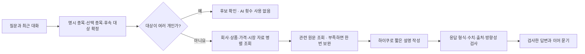

# 주비 채팅: MUU 실패와 작은 화면 보완

## 결과와 범위

1차 질문 연결 배포(DL2) 이후 사용자가 MUU 선택 화면의 디자인·답변 실패를 다시 제보했다. 운영에서 같은 선택 상태로 공개 질문 “왜 이렇게 떨어지는 거야?”를 보내502를 재현했다. 마이크론MU 성공을 MUU 및 모든 종목의 성공으로 확대하면 안 된다.

이번 수정은 기존 질문 처리 경로를 고친 것이다. 별도 개선 엔진이나 예약 AI 호출을 추가하지 않았다. 최신 배포 식별자와 운영 재시험은 `artifacts/joobi-chat-followup-20261106/RELEASE.md`에 기록한다.

## 실제 원인

- **단일 종목 배수 상품 후처리 충돌:** AI가 답한 후 기존 멘토용 `enforceLeverageReport`가 내용을 정적 위험 안내로 덮어썼다. 그 안내의 “추천하지 않고, 매수…”가 다음 방향성 검사에 걸려 전체 답변이502로 끝났다. 직접 질문은 중립 응답 계약과 공통 방향성 검사를 그대로 거치되 멘토용 덮어쓰기는 적용하지 않는다. 매매 지시가 여전히 차단되고 횟수가 차감되지 않는 API 회귀검사를 추가했다.
- **생성 중단:** 공개 MUU 검사에서4096출력 토큰 제한에 도달해 JSON 완성 전에 중단됐다. 직접 질문의 상한을6144로 조정하고 원인 질문에는 중복 숫자·가상 수익 계산을 쓰지 않도록 했다. 토큰 상한은 실제 사용량이나 답변 길이 목표가 아니다.
- **선택 종목·시장 불일치:** 명시적인 종목명이 없는 질문에서 MUU를 선택했어도 질문의 시장 필드는 초기 한국 시장으로 남았다. 선택한 미국 종목도 서버가 미국 시장으로 정규화한다.
- **기초 회사 누락:** 상품 이름만 검색하는 대신 공식 상품 자료로 확인한 기초 회사의 기사·가격·사업 설명을 함께 가져온다. MUU→MU를 추가했고 같은 경로가 기존 TSLL→TSLA에도 적용된다. 모든 단일종목 상품의 관계를 확인한 것은 아니다.
- **작은 화면의 입력 비중:** 종목 선택, 큰 테두리, 입력, 두 줄 안내가 한 덩어리로 차지했다. 종목 선택을 입력 테두리 바깥으로 옮기고 입력/전송을 한 줄로 배치했다. 초안 길이에 따라 입력만 늘어나며, 최초 명시 동의는 유지하고 자세한 범위는 펼쳐 읽는다. 전송 직후 입력 포커스를 풀어 모바일 키보드가 답변 공간을 가리지 않게 한다.

MUU의 기초 회사·하루 목표는 [SEC 공식 요약 투자설명서](https://www.sec.gov/Archives/edgar/data/1424958/000119312526078542/d51121d497k.htm)에서 확인했다. 운용사 페이지도 출처 링크로 유지한다. 최신 수수료·보유 비중은 이 수정에 추가하지 않았다.

## 질문 처리의 공통 흐름

단계는 서버가 실제 해당 작업에 들어갈 때 화면에 보낸다. 검수 전 모델 문장은 사용자에게 스트리밍하지 않는다. 실패 코드·진행 시각·생성 중단/계약 검사 분류를 기록하되 사용자 질문·답 원문은 운영 진단 로그에 저장하지 않는다.

## 추가로 발견한 시세 문제

실제 공급자가 SOXX의 전일450.41과 당일138.97을 반환하면서 분할 이벤트를 주지 않아 기존 계산은 하루 약69%하락을 만들었다. 이것이 실제 폭락인지 분할·수정주가 혼합인지 해당 자료만으로 확정할 수 없다. 이제 하루 가격비가0.5미만/2초과인 구간은 검증 대기 자료로 제외한다. 여러 날 비교도 중간의 큰 단절을 검사한다. 실제로 큰 움직임이 있더라도 별도 확인 전에는 가격 비교에서 빠지는 보수적 제한이며, 정상적으로 확인된 약22%하락은 제외하지 않는 회귀검사를 넣었다. 원인을 임의로 ‘분할’로 단정하지 않는다.

## 검증 기록

- 전체 로컬2219통과/13생략, TypeScript 통과, 변경 파일 lint 통과.
- MUU 운영 수정 전:41.6초 뒤502. 원인 격리 중에는 후처리 차단, 생성 미완성, 수치 계약 거절을 각각 관찰했다. 실패 기록도 보관한다.
- 공개 생성 검사 수정 후:23.6초 및36.4초에 계약·방향성 검사 통과. 인증/쿼터/운영 네트워크를 제외한 값이다.
- 최종 로컬 인증 요청:49.6초에200, MUU/미국/최근 거래일로 응답. 임시 계정 정리 확인. 단계상 준비7.3초, 자료2.6초, 기사8.3초, 생성·비용기록21.5초, 마지막 기록5.8초가 관찰됐다. 개발 서버·외부 네트워크 영향이 섞인 단일 측정이다.
- Chrome 실제 화면390×360에서 입력·포커스·한글 초안 유지 확인. 브라우저 연결 도구가 불가해 native Chrome을 사용했고 사용자의 활성 창과 충돌할 때 별도 창으로 다시 확인했다. 실제 아이폰 키보드/로그인 UI/다크의 전체 흐름은 미검증이다.

## 완료로 부르지 않는 부분

- **속도:** 최종 응답은 여전히 수십 초다. 단계 표시가 빠른 것과 답변이 빠른 것은 다르다. 모델을 low로 내리는 방안은 이전 의미 오류 때문에 채택하지 않았다. 운영 P50/P95와 실패 유형 집계, 인증·이용량 기록의 지연을 다음 최적화 대상으로 삼는다.
- **정확성:** 코드 검사는 모든 의미·인과관계를 증명하지 않는다. 원인 문장과 실제 본문의 연결, 반복 문장과 초보자 이해를 계속 검수해야 한다.
- **종목 찾기:** 정확한 이름·별칭·티커와 문맥 연결은 구현됐다. 오타의 온라인 후보 보완, 여러 회사 동시 비교, 미확인 단일종목 상품의 기초 회사 자동 검증은 남았다.
- **관찰·관리:** 실패 분류/시간 로그와 회귀검사는 추가됐지만 사용자 평가 버튼과 운영 대시보드는 아직 없다. 이번을 자율 개선 엔진 완성으로 표현하지 않는다.
- **선제 브리핑:** 질문에 대한 기사 조회 개선과 홈 화면 선제 시장 설명은 별개다. 중간선거 관련 선제 설명 누락 TODO는 유지한다.
