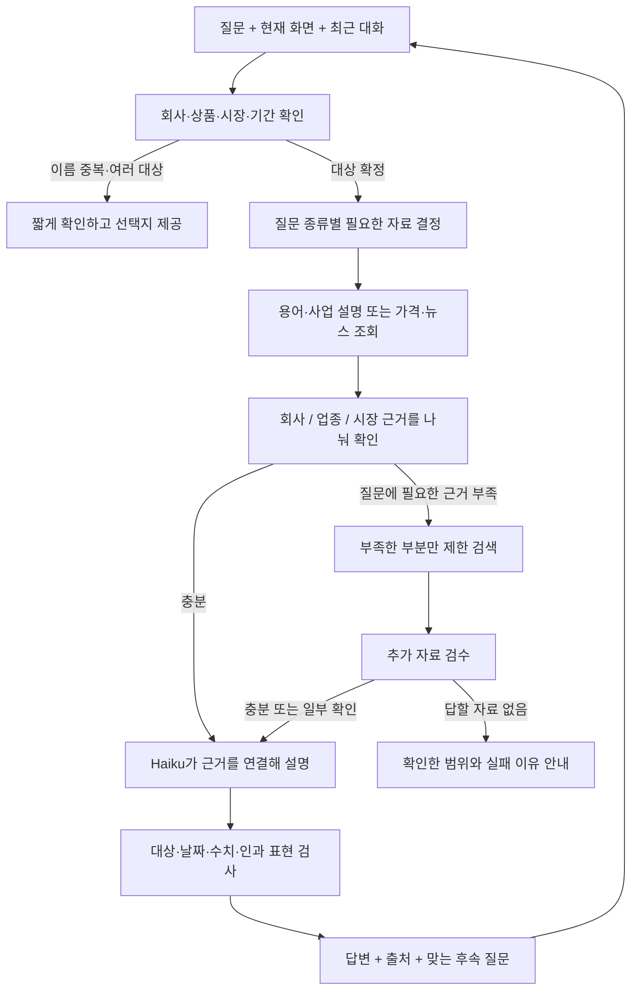

# 주비 대화의 신뢰·종목 연결·응답 속도 설계

> 후속 구현·검수 상태는 [구현 기록](JOOBI_CHAT_RELEASE_2026-11-05.md)을 참고한다. 아래 실측/시제품 표는 설계 시점의 기록이다.

2026-11-05. 설계 및 실측 보고. **전체 구현·운영 적용 완료를 뜻하지 않는다.**
운영 기준: dpl_8a4FS6uwxXiYn2QEP7RpseihLP3S.
시제품: /private/tmp/joobi-chat-quality-20261105. 운영 정본과 분리했다.

## 해결해야 할 실제 결함

사용자 질문은 “마이크론은 왜이렇게 떨어지는거야?”였다. 답변은 국내 시장 기사만 설명하고 마이크론은 확인할 수 없다고 끝났다.

1. 현재 서버는 `parseAssistantQuestion`으로 선택 종목만 읽는다. 자유 질문의 회사명은 조회 종목으로 연결하지 않는다. 미선택+한국 시장 기본값이면 `^KS11`을 조회한다. 실제 같은 질문의 기존 경로 시험에서도 이를 재현했다. 당시 사용자 요청 로그를 식별한 것은 아니다.
2. MU로 연결해도 첫 실측에서 본문 1개만 확보됐다. 제목은 하락 기사였지만 본문은 주로 실적 전망으로, 원인을 설명하기에 부족했다. 종목 일치·날짜·원문 확보가 곧 질문에 답할 근거 충분성을 의미하지 않는다.
3. 형식·숫자·허용 근거 ID 검사만 통과하면 답변이 제공된다. 의미상 “마이크론만 하락” 같은 과장, 출판사 이름 혼동, 질문에 답하지 못하는 설명은 놓칠 수 있다.
4. 생성 완료 뒤 JSON 전체를 한 번에 보내므로 사용자는 검색 중인지 생성 중인지 알 수 없다.

## 목표와 범위

주비가 사용자의 질문 대상을 알아듣고, 맞는 시점의 근거를 찾아 쉬운 말로 연결하며, 이어 묻는 질문에도 같은 맥락을 유지하게 한다. 새 프레임워크나 자율 개선 모델을 추가하기보다 기존 Next.js API, 종목 검색 목록, 공개 자료 수집, 대화 저장소를 연결한다.

검색 보완은 최대 1회. 무한 재검색·무한 재생성을 하지 않는다. 근거가 전혀 없으면 정상 답변인 것처럼 사용 횟수를 차감하지 않는 기존 정책을 유지한다. 일부 근거만 있는 경우 확인한 내용과 조건부 해석을 구분하고, 기사의 단순 요약으로 끝내지 않는다.

## 1. 종목과 대화 대상

- 우선순위: 이번 질문의 명시적인 회사/티커 → 직전 대화에서 확정한 대상 → 보고 있는 종목 → 사용자가 선택한 시장. 이름이 바뀌면 과거 대상의 자료를 섞지 않는다.
- 종목 목록의 공식 이름, 한국어 이름, 관리하는 별칭, 거래소·티커를 함께 사용한다. 모델이 티커를 만들어내게 하지 않는다.
- 마이크론→MU, 하나마이크론→067310.KQ, MUU→별도 ETF. 이름 일부가 겹쳐도 다른 상품이다.
- 구글처럼 주식 종류가 여럿이거나 두 회사가 동시에 나오면 임의로 첫 종목을 고르지 않는다. 회사별 비교 요청이면 비교 경로로, 한 대상이 필요한 요청이면 선택지로 연결한다.
- 오타는 후보 제안까지만 한다. 비슷한 이름을 확정해서 답하지 않는다. 검색 실패 때 한국 시장으로 조용히 바꾸지 않는다.
- “그럼 왜?”, “더 쉽게”, “이번엔 테슬라는?”를 구분한다. 이전 AI 답변은 근거가 아니라 대화 문맥이다.
- 각 답변에 대상 이름·티커와 자료 기준 거래일을 짧게 표시한다. 사용자가 연결 결과를 알아볼 수 있어야 한다.
- 같은 탭의 최근20개 보관과 직전3개 전달 정책 유지. 장기 기억·기기 간 동기화는 제공한다고 말하지 않는다.

제안 내부 계약:
`QuestionContext {subject, market, instrumentType, intent, period, asOf, resolutionSource, ambiguity, priorContextId}`
`resolutionSource`는 질문/직전대화/상세화면/시장선택 중 하나다. 원문을 영구 로그에 넣기 위한 필드가 아니다.

시제품은 공식 목록 스냅샷+기존 별칭의 정확한 이름/티커와 질문 이력을 연결한다. 운영 적용 전 최근 상장·이름 변경, 명시적 시장 전환, 선택과 질문 충돌, 비교 질문, 오타 후보 선택까지 검증해야 한다. 모든 회사에 대한 완전한 자연어 이해가 구현된 것은 아니다.

## 2. 필요한 자료만 조회

| 질문 | 필요한 자료 | 생략할 일 |
| --- | --- | --- |
| ETF가 뭐야? | 검수된 용어 정의·예시 | 시세 조회·뉴스 검색 |
| 이 회사는 뭘 팔아? | 해당 회사의 사업·제품·출처 | 시장 기사 검색 |
| 왜 떨어졌어? | 같은 기간 회사·업종·시장 가격 + 관련 본문·공시 | 무관한 국내/해외 시장 기사 |
| 그게 제품과 무슨 관계야? | 직전 사건 근거 + 회사 사업 설명 | 유효한 자료를 처음부터 재검색 |
| 이번엔 다른 회사는? | 새 회사 자료 + 필요 시 같은 시장 사건 | 이전 회사의 수치·고객을 재사용 |

시세·사업 설명·기존 공개 자료는 독립적으로 병렬 수집한다. 최신 사건 질문에는 기사 제목이 아니라 본문과 공시를 확인한다. 시세 공급 실패가 모든 회사 뉴스 검색을 막지 않도록 기간 확정과 시세 성공을 분리하되, 가격을 못 받은 상태에서 등락을 단정하지 않는다.

## 3. 근거를 확인하는 기준

각 자료에 대상/시장/사건 시각/게시 시각/자료 확인 시각/출처/원문 확보 여부를 둔다. 다음 세 층을 섞지 않는다.

- 회사: 해당 회사에 실제 생긴 일인가? 사업·제품 자료와 연결되는가?
- 업종: 같은 분야의 가격과 사건인가? 국내 반도체 기사라는 이유만으로 미국 회사의 원인으로 사용하지 않는다.
- 시장: 금리·정책·선거 같은 공통 사건인가? 보도 해석과 확정된 결과를 구분한다.

단순한 최신 날짜·회사명 포함·본문 글자 수로 “충분”을 판정하지 않는다. 하락 질문인데 실적 전망만 있으면 회사 소식은 확보됐어도 하락 배경은 빈 상태다. 남은 검색은 그 빈 부분을 찾아야 한다.

각 설명을 `가격에서 관찰한 사실`, `보도가 제시한 배경`, `조건부 영향 경로`, `아직 모르는 부분`으로 구분한다. 출판사 이름은 출처 메타데이터에서 표시하고 모델이 새로 만들지 않게 한다. 핵심 답변에도 근거 ID를 연결한다. ID가 실제 존재한다고 문장의 의미까지 증명되는 것은 아니므로 아래 회귀 검수가 함께 필요하다.

## 4. 사용자가 읽는 답변

첫 문장: 이번 질문에 대한 핵심. 이어서 사건→왜 이 회사와 연결되는지→아직 확인되지 않은 부분을 2~3문장으로 설명한다. 근거·수치 비교는 펼쳐 읽는다.

예시 구조(실제 시장 사실을 채워 넣은 답이 아님):
“이번 하락은 [보도에서 확인한 배경]과 함께 살펴볼 수 있어요. [사건] 때문에 [이 회사 제품을 사는 쪽의 주문/투자]가 달라질 수 있기 때문이에요. 다만 [실제 확인하지 못한 회사별 사실]까지 확인된 것은 아니에요.”

매번 이 틀을 그대로 반복하지 않는다. 용어 질문에는 뜻부터, 제품 질문에는 쓰임부터 답한다. 자료가 없다는 문장을 반복하거나 근거 없는 원인을 자신 있게 말하는 방식 모두 실패다.

후속 질문은 실제 답의 빈 부분과 다음 조회 가능 범위에서 고른다. 하락 질문 뒤 뜬금없이 사전 퀴즈로 돌리지 않는다. “다른 회사도 그래?”에는 사용자의 보유 목록을 안다고 가정하지 않는다.

## 5. 속도 실측

측정일 2026-11-05, Haiku 5.5. 등록 API를 이용한 로컬 공개 질문 파이프라인. 계좌·개인 메모 전송 없음. 인증/할당량/장부 쓰기/주비 서버까지의 왕복/화면 렌더링은 제외했다. 각 조건 1회이며 운영 평균·P95가 아니다.

| 조건 | 종목 확인 | 사업 | 시세·기존 뉴스 | 기사 검색·본문 | 답변 생성 | 합계 |
| --- | ---: | ---: | ---: | ---: | ---: | ---: |
| 기존 미선택 경로(코스피 오조회) | — | — | 1.29초 | 5.86초 | 11.36초 | 18.51초 |
| MU로 연결한 첫 질문 | 0.005초 | 0.51초 | 1.40초 | 6.28초 | 15.40초 | 23.60초 |
| 같은 대상 후속 질문 | 0.014초 | 0.14초 | 캐시 | 캐시 | 11.41초 | 11.57초 |

현재 회사 사업 설명→시세·뉴스→기사 연구→답변 생성을 순차 대기한다. 기사 수집 자체도 LLM이 검색/본문 도구를 쓰는 별도 호출이다. 이후 답변을 만드는 두 번째 모델 호출이 있다. 두 호출의 제한 시간은 각각28초/45초이고, 클라이언트 대기 제한은110초다. 제한 시간은 실제 소요 시간이나 보장 응답 시간이 아니다.

공개 근거 캐시는 프로세스 안에만 있다(시세1분, 기사5분). 같은 인스턴스에서는 도움이 되지만 새 서버 인스턴스·배포에서는 재사용되지 않는다. 기사 캐시 키는 종목/기간/거래일이므로 장중 자료 갱신과 사건 변경도 고려할 필요가 있다.

동일 자료를 넣고 생성 강도를 비교한 별도 실험:

| 질문 | medium 생성 | low 생성 | 첫 JSON 조각 medium / low | 판정 |
| --- | ---: | ---: | ---: | --- |
| 마이크론 하락 | 14.41초 | 9.94초 | 12.95초 / 7.90초 | low가 “마이크론만” 하락이라고 표현. 업종도 하락해 채택 불가 |
| ETF 뜻 | 2.98초 | 2.79초 | 1.28초 / 1.21초 | 1개 사례로는 유의미한 개선·품질 유지 입증 불가 |

첫 JSON 조각은 사용자에게 읽어줄 검증된 첫 문장이 아니다. `valid=true` 및 `blocked=0`여도 의미 오류가 나왔다. 자동 검사 개수를 답변 신뢰도로 보고하면 안 된다.

## 6. 속도 개선 순서

1. 독립 조회 병렬화와 불필요한 조회 제거. 후속 용어 풀이에 최신 기사 연구를 다시 하지 않는다.
2. 기존 수집 작업의 공개 시장/업종 자료를 공유 저장소에 재사용. 인기 질문과 실제 조회 종목부터, 전 종목 선제 AI 생성은 하지 않는다. 거래일·기준 시각·기사 집합 버전으로 만료시킨다.
3. 같은 공개 근거를 재사용해도 사용자 답변·대화를 공용 캐시에 섞지 않는다. `sourceSnapshotId`로 같은 근거 묶음인지 판별한다.
4. 실제 서버 단계 이벤트를 UI에 전달한다. “마이크론 자료를 찾고 있어요”→“관련 보도를 확인하고 있어요”→“설명 정리 중”. 타이머로 가짜 진행 단계를 만들지 않는다.
5. 문장/출처 검사를 통과한 부분부터 표시하는 전송 방식을 설계한다. 현재 JSON 검사를 버리고 미검증 원문을 그대로 흘리지 않는다. 우선 단계 이벤트만으로 상태를 알 수 있게 한다.
6. 고정 프롬프트 캐싱·필요 없는 자료 축소를 시험한다. `low`는 전체 적용하지 않고 쉬운 용어 질문의 별도 검수군으로 비교한다. 숫자·원인 해석은 품질 기준부터 통과해야 한다.

첫 상태 표시1초 이내, 용어 설명5초 이내, 최신 뉴스 설명15초 안팎을 **초기 검증 목표**로 둔다. 달성 사실이 아니다. 실제 출시 판단에는 요청 입장부터 표시까지의 P50/P95와 실패율을 수집한다. 느린 답변을 숨기기 위해 자료 확인을 빼지 않는다.

## 7. 지속 관리와 출시 기준

- 고정 공개 질문 회귀 세트: 국내/해외·주식/ETF·동명이름·오타·신규종목·휴장·장중/마감·시장변경·후속질문·자료장애를 나눈다. 마이크론만 통과해서 전체 완료 처리하지 않는다.
- 이번 실제 실패들을 사례로 추가: 미선택 마이크론→코스피, MU/MUU 혼동, 하나마이크론/MU 혼동, 함께 하락했는데 “이 종목만”, 기사 출판사 이름 혼동, 제목만 원인으로 사용, 다른 종목으로 전환한 뒤 이전 수치 재사용.
- 매 변경 시 고정 근거 테스트, 출시 전 소수 실제 공개 질문, 출시 후 오류/느린 단계 확인. 고비용 전수 모델 호출을 정기 실행하지 않는다.
- 자동 검사는 티커·거래일·수치·출처 연결·미지원 주장 패턴·완료/실패 여부를 확인한다. 인과 설명과 초보자 이해는 실제 답을 읽는 검수 및 사용자 피드백으로 확인한다.
- 사용자 피드백은 “다른 종목 같아요 / 질문과 달라요 / 어려워요 / 출처가 부족해요”처럼 문제를 구분한다. 질문·답변 원문은 자동 영구 수집하지 않는다. 공개 테스트로 재현하거나 사용자가 별도로 동의한 사례만 검수 자료로 쓴다.
- 운영 기록: 익명 요청 ID, 단계별 소요시간, 캐시 적중, 자료 개수/범위, 실패 코드, 모델/프롬프트 버전, 사용 토큰. 개인 질문·보유 목록·수량·매수가는 로그에서 제외한다.
- 배포 차단: 잘못된 종목/날짜/숫자, 제목을 사실로 확정, 근거 없는 단정 사례가 나오면 수정 후 재검증. 형식 통과만으로 승격하지 않는다.
- 반복 오류는 목록·자료 연결·검색·프롬프트 중 책임 지점을 찾아 수정한다. “개선 엔진이 스스로 운영 프롬프트를 계속 바꿈”은 사용하지 않는다. 수정안→회귀검사→실제 답 검수→선별 배포→되돌리기 가능한 기록을 남긴다.

## 구현 순서 및 현재 상태

| 순서 | 작업 | 현재 상태 |
| --- | --- | --- |
| 1 | 질문 대상 연결·후속 맥락 | 격리된 시제품 및 회귀검사13개. 서버 운영 미적용 |
| 2 | 자료 충분성·부족한 부분만 재검색·근거 계약 | 설계 완료, 구현 필요 |
| 3 | 병렬화·공개 근거 공유 캐시·실제 단계 이벤트 | 설계 완료, 구현 필요 |
| 4 | 문장 검수·대표 질문군·운영 지표 | 답변 생성7회와 별도 기사 검색의 결과·실패 사례 확보. 운영 계측 필요 |
| 5 | 채팅 입력 화면 | 격리된 로컬 시제품. Chrome 데스크톱·390×360 확인. 큰 창 아래 빈 공간과 작은 창 입력 영역 추가 조정 필요 |

완료 기준은 “엔진이 존재함”이 아니라, 같은 질문에 맞는 대상·근거·쉬운 답이 나오고 이어 묻기까지 유지되는 것이다. 현재 검색 근거와 문장 품질은 그 수준에 이르지 못했다.

## 근거

- 실측: `artifacts/joobi-chat-quality-20261105/latency-live.json`, `effort-live.json`. 기사 본문 재배포 없음.
- 코드: `src/app/api/ai-analysis/route.ts`, `assistantQuestion.ts`, `assistantEvidenceSource.ts`, `assistantArticleSources.ts`, `claudeAnalysis.ts`, `AskJoobi.tsx`.
- Anthropic 지연 안내: https://platform.claude.com/docs/en/test-and-evaluate/strengthen-guardrails/reduce-latency
- 생성 강도: https://platform.claude.com/docs/en/build-with-claude/effort
- 프롬프트 캐싱: https://platform.claude.com/docs/en/build-with-claude/prompt-caching
- 기존 디자인 조사: `docs/design-research/benchmark.json`. 24개 서비스 공식 자료 조사이며 로그인 사용성·응답속도 실측 비교가 아니다.
