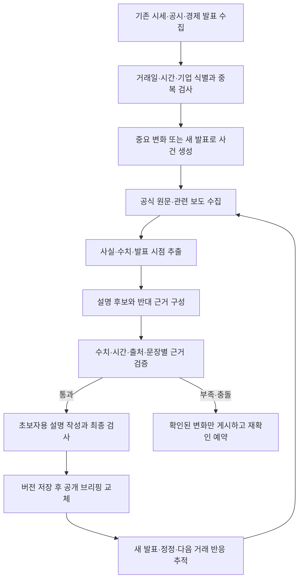

# 시장 배경 자동 설명 엔진 설계

작성: 2026-10-31. 상태: **구현 설계안**. 이 문서는 운영 자동 원인 설명 완료를 뜻하지 않는다.
운영 기반: `docs/MARKET_FLOW_ENGINE.md`, 배포 `dpl_22pBebmk7Rw9oPcRrathUHZCuKsJ`.

## 1. 목표와 완료의 의미

사용자가 묻기 전에 중요한 시장 변화를 발견하고, 당시에 확인할 수 있는 원문에서 배경을 찾아 쉬운 한국어로 설명한다. 새로운 사실이 나오면 이전 설명을 자동 갱신·정정한다. 일상적인 실행에 운영자의 기사 선택/문구 작성/승인이 필요하지 않아야 한다.

완전 자동화는 모든 등락에 원인을 확정한다는 뜻이 아니다. 근거 수집 → 설명 가능 여부 판단 → 게시 또는 보류 → 재확인까지 자동이어야 한다. 시장의 인과관계는 관찰 자료만으로 확정할 수 없는 경우가 많다. 보류가 정상적인 결과이며, 근거 없이 이유를 채워 넣어 게시율을 높이지 않는다.

기본 출력은 ‘주요 배경’, ‘회사 발표 내용’, ‘보도에서 제시한 해석’, ‘확인되지 않은 연결’을 구분한다. ‘이 사건 때문에 정확히 몇 % 떨어졌다’, ‘원인 확률 92%’를 만들지 않는다. 시장 공통 배경·업종별 차이·기업 고유 사건이 함께 있을 수 있다.

## 2. 현재 구현과 추가할 부분

| 영역 | 현재 운영 | 추가할 설계 |
|---|---|---|
| 변화 발견 | 지수/업종 ETF/고정 기업8개, 시각 정합성·등락 비교 | 사건 단위 중요도·계속 추적·같은 사건 묶기 |
| 원인 근거 | 날짜 지정 수동 검증 설명2개 | 등록된 공식 원문 수집·구조화·수치 검증 |
| 보도 | 관련 기사 제목/링크 | 이용 가능한 본문·발행 이력·재전송 관계 확인 |
| 설명 | 편집 자료 + 자동 수치 문장 | 근거 ID에 연결된 주장·전달 경로·대안 생성 |
| 게시 | 공개 feed 읽기 시 계산 | 검증 통과한 불변 버전 저장·원자적 게시 |
| 후속 | 최신 관측 표시 | 반대 증거/정정/철회와 이전 설명 비교 |
| 개인 연결 | 브라우저 내 보유 종목 일치 | 공개 사업 관계 기반 기기 내 관련성 표시 |

고정8개 기업을 전 시장으로 표현하지 않는다. 대상 확대는 공개 기업 목록/공식 기업 식별자/원문 접근/수집 예산/검증 성능이 갖춰진 그룹부터 한다. 숨겨진 사용자 보유 목록을 서버 관찰 대상으로 전송하지 않는다.

## 3. 처리 흐름



역할은 처리 단계이며 서로 대화하는 여러 에이전트를 반드시 운용한다는 뜻이 아니다. 초기에는 기존 Next 서버의 제한된 배치 작업, 순수 검증 함수, 기존 AI 공급자 어댑터로 구성한다. 프레임워크/새 공급자 도입은 필수 조건이 아니다.

## 4. 발견과 우선순위

- 두 진입점: 가격 이상 변화와 새로운 공식 발표. 발표 전후 가격이 작게 움직여도 중요한 정책/실적은 탐지한다.
- `marketFlowEngine.ts`의 기존 비교는 유지한다. 수집 누락·기준 시점 차이를 먼저 검사한다.
- 고정 등락 기준과 종목의 평소 변동 대비 이례성을 함께 사용한다. 표본 부족 시 통계 판단을 하지 않는다. 분할·배당락·합병·거래 정지·오류 시세를 먼저 후보에서 분리한다.
- 시장 공통 사건은 복수 지수·업종·금리·환율의 확인된 변화로 범위를 잡는다. 지수 하락을 전 종목 하락으로 확대하지 않는다. 상관관계 자체를 원인 증거로 사용하지 않는다.
- 우선순위는 중요도 등급, 자료의 새로움, 영향 범위, 대기 시간 순이다. 설명 신뢰도와 우선순위를 같은 점수로 만들지 않는다.
- 사건 ID는 회사/발표 식별자/사건 종류를 우선 사용하고, 가격 이상은 시장·거래일·관측 구간으로 생성한다. 같은 사건의 매10분 관측마다 새 분석을 만들지 않는다.
- 기존 보고서에 새 자료·정정·중요한 상태 변화가 없으면 다시 생성하지 않는다. 가격 수치 갱신은 별도 결정적 계산으로 처리한다.

## 5. 원천과 접근 정책

| 원천 | 얻는 것 | 얻지 못하는 것 |
|---|---|---|
| SEC 공시/회사 IR | 실제 실적, 전망, 회사의 설명 | 시장 전체 하락의 입증, 보편적인 컨센서스 |
| DART/거래소/회사 IR | 국내 공시, 공시 정정, 공식 시장 조치 | 모든 한국 기업의 분 단위 실적 예상 |
| 연준/BLS/BEA/한국은행 등 등록 공식 발표 | 정책·경제지표와 수정치 | 발표가 주가를 움직인 정도 |
| 접근 권한을 확인한 보도 본문 | 시장 참여자 해석과 다른 쟁점 | 기사에 쓰인 해석의 인과적 확정 |
| 기존 시세 공급 | 관측된 가격과 기준 시각 | 투자자 동기·자금 유출입·실시간 보장 |

SEC는 기업별 제출 이력과 XBRL API를 제공한다. 공시 접수 시점과 원래 보도자료 발표 시점이 다를 수 있다. XBRL은 태그/기간/단위/연결 범위 검증을 거쳐 사용한다. [SEC 공식 API 안내](https://www.sec.gov/search-filings/edgar-application-programming-interfaces).

OpenDART는 공시검색과 공시서류 원본 파일 접근 기능을 제공한다. 실제 키/한도/이용 조건은 연결할 때 확인한다. [OpenDART 개발가이드](https://opendart.fss.or.kr/guide/main.do?apiGrpCd=DS001).

출처 등록부에는 공식 기업 ID(CIK/corp_code), 도메인, 허용 경로, 콘텐츠 유형, 접근 방식, 갱신 정책, 재배포/보존 범위, 속도 제한을 기록한다. 공식 웹페이지가 공개됐다고 모든 콘텐츠를 무제한 복제·재배포하지 않는다. 이용 조건이 미확인된 보도는 링크/메타데이터 수준에서만 사용하고 원인 검증 본문으로 승격하지 않는다.

수집기는 등록 원천만 접근한다. 모델이 만든 URL을 바로 fetch하지 않는다. 리다이렉트마다 목적지와 공인 IP를 다시 검사하고 내부망/메타데이터 주소, 자격증명 URL을 차단한다. 문서의 명령문은 데이터로 취급하며 비밀·DB 쓰기·발송 도구를 모델에 주지 않는다. 압축 원문/PDF는 파일 수·압축 해제 크기·시간 한도를 둔다. OCR이 필요한 수치가 불확실하면 게시 근거로 사용하지 않는다.

## 6. 시간과 사실 계약

원문마다 다음을 구분한다.

- `publishedAt`: 공급자가 명시한 최초 공개 시각. 불명이면 null과 시각 정밀도 기록.
- `firstSeenAt`: 주비가 처음 발견한 시각. 원래 발표 시각을 대신하지 않는다.
- `retrievedAt`: 이번 가져오기 시각.
- `effectiveAt`: 정책 시행 시점 또는 사실의 효력 시점.
- `periodStart/end`: 실적/지표의 집계 기간.
- `asOf`: 가격 관측 시점, 시장·타임존·정규장/시간외 구분.

발표 후 작성된 마감 해설은 ‘당시 공개된 원인’으로 소급하지 않는다. 늦게 발견한 원문은 발견 전 브리핑에서 알고 있었던 것처럼 재현하지 않는다. 발표 시각이 날짜 수준이면 장중 선후관계를 주장할 수 없다. 한국 ‘어제’와 미국 거래일은 별도 변환한다.

추출 수치는 원문 표/문단 위치, 원래 표현, 정규화 값, 통화·단위, 기간, GAAP/조정 여부, 실제/예상/전망/수정치 구분을 가진다. 계산은 코드가 수행하며 식과 피연산자 근거 ID를 남긴다. 억/십억, 분기/연간/최근12개월, 전년/전분기, 증가분/총액을 섞으면 거부한다.

‘예상보다 낮다’에는 발표 전에 공개된 같은 기간·동일 회계 기준 예상치가 필요하다. 없으면 전망 수치 자체만 설명한다. 사후 목표가를 발표 전 예상으로 쓰지 않는다. 수정 전/후 경제지표는 별도 버전이다.

## 7. 사건과 주장 데이터 계약

아래는 논리 계약이며 아직 생성한 운영 테이블/실행 코드가 아니다.

```ts
type ClaimKind = 'fact' | 'reported_attribution' | 'mechanism' | 'scenario';
type Assessment = 'supported' | 'unsupported' | 'conflicting' | 'not_applicable';
interface EvidenceRef {
  documentVersionId: string;
  locator: string;           // 문단/표 셀/페이지, 저장 텍스트와 일치
  excerptHash: string;       // 검증 가능한 원문 조각 해시
}
interface Claim {
  id: string;
  kind: ClaimKind;
  text: string;
  scope: 'market' | 'sector' | 'company';
  entityIds: string[];
  evidence: EvidenceRef[];
  dependsOn: string[];       // 다른 주장/정규화 사실 ID
  contradicts: string[];
  checks: {
    identity: Assessment; timing: Assessment; numbers: Assessment;
    sourceSupport: Assessment; scope: Assessment;
  };
}
interface ExplanationVersion {
  eventId: string; version: number; asOf: string;
  inputHash: string; policyVersion: string; modelVersion: string;
  claims: Claim[];
  disposition: 'facts_only' | 'explained' | 'conflicting' | 'withdrawn';
  reasonCodes: string[];
  followUps: { condition: string; dueAt: string; sourceIds: string[] }[];
  supersedes: string | null;
}
```

추상적인 증거 개수보다 주장별 지지를 본다. 공식 원문 한 개는 회사 발표 사실에 충분할 수 있지만 그 발표가 전체 증시 하락을 일으켰다는 증거는 아니다. 통신사 원문을 재전송한 여러 매체는 독립 증거 한 계열로 묶는다. 서로 다른 모델 두 개가 같은 답을 내도 독립 증거가 아니다.

## 8. 설명 후보와 검증

1. 구조화된 사실과 승인된 영향 경로 자료를 입력해 후보를 만든다. 원문과 보도에서 지원되는 최대3개 배경을 제안한다.
2. 후보마다 사건 → 중간 변화 → 기업 실적 기대/평가 경로를 구성한다. 각 연결에 실제 관측/일반 경로/가정 표식을 붙인다. 중간 근거가 없으면 장거리 연결은 시나리오 수준으로 낮춘다.
3. ‘다른 이유는 없는가’를 검사한다. 회사 전망, 금리 변화, 정책, 기술적 조정 등 확인된 경쟁 설명과 반대 증거를 찾는다. 매번 모든 후보를 강제로 채우지는 않는다.
4. 결정적 검사로 기업/날짜/수치/단위/근거 위치를 확인한다. 의미 검사는 주장과 원문을 대조해 지원되지 않는 범위 확대를 찾는다. 검증 모델도 실패할 수 있으므로 모델 판단만으로 hard gate를 통과시키지 않는다.
5. 검증된 주장만으로 읽기 쉬운 문장을 작성한다. 작성 후 문장별 claim ID 연결과 수치 일치를 다시 검사한다. 문장을 매끈하게 만드는 과정에서 새로운 사실을 추가하면 거부한다.
6. 숫자/출처 링크는 구조화 값으로 렌더링한다. 모델의 HTML/URL/스크립트를 그대로 출력하지 않는다.

검증 실패 시 보정은 최대1회. 계속 실패하면 확인된 사실만 게시하고 이유 코드를 기록한다. 실패를 숨기기 위한 모델 무한 교체를 금지한다.

## 9. 자동 게시 규칙

| 결과 | 조건 | 사용자에게 보여줄 것 |
|---|---|---|
| `facts_only` | 가격/발표 사실 검증 통과, 설명 근거 부족 | 확인된 변화 + 배경 확인 중 + 다음 확인 시점 |
| `explained` | 모든 게시 주장 근거 연결, 수치/시각/범위 검사 통과, 중대한 충돌 없음 | 주요 배경·사실/해석 구분·달라질 조건 |
| `conflicting` | 신뢰 가능한 자료가 충돌하고 해소되지 않음 | 확인된 사실 + 무엇이 엇갈리는지, 단일 결론 보류 |
| `withdrawn` | 기존 설명의 핵심 근거 정정/철회 또는 검증 오류 | 정정 내용·이전 설명의 변경 이유·유효한 관측 |

단일 ‘신뢰도70점’으로 부족한 시간/출처 검사를 상쇄하지 않는다. 독립 보도2건이 있다는 이유만으로 가격 인과관계를 확정하지 않는다. `reported_attribution`은 ‘해당 보도는 이런 배경을 지목했다’로 귀속해서 쓴다. 회사가 밝힌 사업 원인과 주식시장 가격 원인은 분리한다.

중대한 출처 철회는 새 설명 생성 성공을 기다리지 않고 해당 주장을 먼저 비노출 처리한다. 근거 문서→사실→주장→보고서의 역참조로 영향받는 버전을 찾고 정정한다. 원문을 사용할 권한이 허용하는 범위에서 검증 조각/해시/버전 이력을 보존한다. 원문 조각을 보존·재현할 수 없으면 재현 불가능 상태를 표시하고 자동 게시 범위를 제한한다.

## 10. 저장·실행·장애 처리

논리 저장소는 `source_documents`, `event_facts`, `explanation_jobs`, `explanation_versions`와 사건별 현재 게시 버전 포인터다. 물리 테이블/색인은 구현 단계 migration 검토 후 확정하며 기존 시장 관측 테이블에 매번 거대한 원문을 넣지 않는다.

- 문서 키: source ID + canonical document ID + content hash. ETag/Last-Modified가 있으면 활용한다. 변동 없는 원문 재저장/재분석을 하지 않는다.
- 작업 키: event ID + input hash + policy/model version + stage. lease+owner token으로 중복 실행을 제어한다. lease 만료 후 이전 worker의 쓰기는 fencing 조건으로 거부한다.
- 상태: `queued → claimed → fetched → extracted → verified → rendered → published`. 부족 자료는 `waiting_sources`, 실패는 제한된 재시도 후 `failed`, 정정은 새 버전/withdrawn 전환.
- 단계 결과는 재사용 가능하게 저장하고 공급자 호출의 실제 사용량을 기록한다. 장애 후 정확히한번 외부 호출을 보장한다고 주장하지 않는다. 재시도 중복 비용은 별도 집계한다.
- 게시: 사건 현재 버전과 입력 hash를 확인하는 CAS 트랜잭션. 구버전 작업이 새 정정을 덮지 못한다. 보고서·출처·후속 조건을 완성한 뒤 포인터를 교체한다.
- 공개 GET은 저장 결과만 조회한다. source fetch/LLM/last_seen 갱신을 하지 않는다. 공개 시장 자료 캐시는 모든 이용자가 공유한다.
- DB 쓰기는 입력/상태/게시 변화에만 발생한다. 최근 작업/미완료 작업 색인, 범위 제한 조회와 증분 정리를 사용한다. 매 실행 전체 비용 원장을 읽거나 수만 종목 last_seen을 일괄 갱신하지 않는다.
- 오래된 설명은 표시 시각과 상태를 유지한다. 검증된 최신 설명이 없다고 이전 설명을 오늘 사건에 붙이지 않는다. DB/API 장애 시 기존 공개 관측 흐름을 유지하고 설명만 독립적으로 중단할 수 있어야 한다.
- source timeout/429는 원천별 backoff. 분석 실패가 기존 시세 수집 발행을 실패시키지 않도록 작업 큐를 분리한다.

## 11. 비용과 개인정보

현재 `aiProvider.ts`의 조회 후 fallback 호출/기록과 `aiBudgetGuard.ts`의 원장 합계 확인은 이 자동 작업의 원자적 비용 예약을 대신할 수 없다. 기존 공급자 어댑터는 활용하되 feature별 예산 예약·정산을 추가해야 한다.

초기 제한 제안: 하루 새 설명/중요 갱신 합계40건, 건당 추출·작성·검증·보정 합계 최대4호출, 입력 원문/토큰 상한, 사건당 재시도1회. 이 숫자는 비용·품질 평가 뒤 조정할 설정값이며 운영 적용된 한도가 아니다. 한도에 도달하면 시세 브리핑을 유지하고 새 설명 생성을 다음 기간으로 넘긴다.

비용은 `호출별 입력토큰×입력단가 + 출력토큰×출력단가 + 자료 이용료 + 저장/실행 비용`으로 측정한다. 모델 가격은 구현 시 확인하며 무료 운영을 보장하지 않는다. 고정 기업/시장 공통 보고서를 공유하므로 이용자마다 같은 분석을 다시 생성하지 않는다.

LLM 호출 전에 일/월 최악 예상 비용을 원자적으로 예약하고 완료 후 실제 사용량으로 정산한다. 원장 장애/설정 누락/불명확한 호출 완료는 신규 호출 차단 또는 보수적인 예약 유지로 처리한다. 단순 조회 후 차감으로 동시 호출 한도를 보장하지 않는다.

입력은 공개 시장 자료뿐이다. 사용자 거래/보유 금액/계정 ID/복구키를 수집·프롬프트·로그에 넣지 않는다. 개인 연결은 공개 사업 관계와 기기 내 기록으로 계산한다. 이것이 기존 투자 기록 보관 전체의 비공개 전환 완료를 의미하지 않는다. 푸시는 후속 기능으로 별도 동의/빈도/중복/정정 정책을 설계하며 현재 엔진 설계만으로 발송하지 않는다.

## 12. 사용자가 읽는 형식

첫 화면은 ‘핵심 변화 한 문장 / 확인된 배경 한두 문장 / 다음 확인할 것’으로 끝낸다. 약어는 바로 풀어 쓴다. 상세에서 시장 공통 배경과 회사 고유 사건을 나누고, 근거·반대 조건·내 기록과의 관계를 보여준다.

예시 형식(가상): ‘주요 지수가 함께 내렸지만 모든 업종이 약했던 것은 아니에요. A사는 매출 증가와 함께 설비투자 확대를 발표했어요. 투자가 늘면 당장 남는 현금이 줄 수 있어요. 다만 이것만으로 오늘 시장 전체 하락을 설명할 수는 없어요.’ 실제 사건에서는 통과한 주장만 사용한다.

상태 문구는 실패 종류별로 다르게 한다: ‘공식 발표 전’, ‘발표는 확인했고 수치를 대조 중’, ‘설명 자료가 엇갈림’, ‘수집이 늦어 마지막 자료 표시’. 모두 같은 ‘AI 분석 중’으로 숨기지 않는다. 다음 방문에는 ‘새로 확인된 내용’과 ‘이전 설명에서 달라진 점’을 보여준다.

## 13. 평가와 출시 조건

이 절의 수치는 **제안한 출시 기준**이며 현재 달성한 성능이 아니다.

- 사건 최소200개 평가 세트: 한국/미국, 상승/하락/보합, 거시/기업/정책, 실적 호조 후 하락, 무자료·상충·정정, 분할/배당락, 장후/시차를 층화한다. 시나리오당 최소 표본 수를 지정하고 특정 대형주 사례가 대부분이 되지 않게 한다.
- 개발/정책 조정 세트와 날짜·사건별 홀드아웃을 분리한다. 같은 통신사 재전송·같은 사건 후속을 양쪽에 중복 배치하지 않는다.
- 과거 재현은 그 시점에 이용 가능했던 문서/시세만 사용한다. 당시 원문 버전을 확보하지 못하면 정확도 평가에서 제외하고 제외율을 공개한다.
- 자동 검사 외에 고정된 기준표로 금융 사실 검토와 초보자 이해도 검토를 수행한다. 같은 모델의 자기 평가만으로 승인하지 않는다.
- 모든 게시 문장 근거 연결100%, 수치/기업/기간/거래일 중대 오류0, 근거 없는 원인 단정0을 출시 차단 기준으로 삼는다. 표본에서 오류0을 서비스 오류확률0으로 광고하지 않는다.
- 게시된 주장 근거 일치율 목표98% 이상, 반드시 보류해야 하는 샘플의 보류율95% 이상. 실제 분모·오류 건수·구간 추정도 함께 기록한다. 보류만 해서 통과하지 않도록 설명 가능한 사건의 처리율을 별도로 측정한다.
- 중복 작업/예산 초과/구버전 정정 덮어쓰기/개인정보 유출 검사는0건 허용. 원천 장애·외부 호출 응답 유실·worker 중단·동시 재시도 포함.
- 소스 이용 가능 후 게시 지연 p95 15분을 초기 목표로 측정한다. 공급자 지연은 별도 표시한다. 현행10분 수집 구조에서 실시간 속보를 약속하지 않는다.
- 최소10거래일 비공개 병행 검증 후 사건 유형 단위로 공개한다. 오류 기준을 넘으면 해당 유형을 facts_only로 되돌리고 재검증한다. 사용자별 임의 원인 설명 실험은 하지 않는다.

‘완료’ 보고 조건은 지원 범위/자동 처리율/보류율/근거 오류/정정 처리/비용/관측 기간을 숫자로 제시하고, 미지원 유형을 공개할 수 있는 상태다. 수동으로 채운 보고서 몇 건이 잘 나오는 것으로 완료하지 않는다.

## 14. 구현 순서와 코드 경계

1. **근거 계약과 검증기**: `marketCause/types.ts`, `normalizeFacts.ts`, `validateClaims.ts`, `publicationPolicy.ts`. 합성 fixtures와 시간/단위/중복/충돌 테스트. 기존 운영 설명에 영향 없이 순수 함수부터.
2. **원문 수집과 저장**: `marketCause/sources/*`, `documentStore.ts`. 기업 식별자/출처 등록, SEC·기존 공식 경제 원천부터. 국내 DART는 키·조건·기업 매핑 확인 후 포함. 원문 변경/철회 재현 테스트.
3. **작업과 예산 제어**: `marketCause/jobStore.ts`, `budgetReservation.ts`, `run.ts`. CAS/lease/fencing, 격리 DB 역할 테스트, 운영 쓰기 전 migration 검토.
4. **설명 생성과 검증**: `extractFacts.ts`, `buildHypotheses.ts`, `renderExplanation.ts`. 기존 AI adapter 뒤에 제한된 입력/출력 스키마, 후보별 반대 근거, 문장 단위 검증. 게시 권한은 모델에 주지 않는다.
5. **비공개 병행**: 새 엔진 출력은 shadow 저장, 공개 API는 기존 검증 설명 유지. 홀드아웃·10거래일·비용 및 I/O 측정.
6. **자동 게시와 정정**: `marketWatchStore.ts`가 검증된 게시 버전을 읽도록 연결. 수동 registry는 명시적 편집 자료로 남기고 자동 결과와 출처 구분. 유형별 rollout/kill switch, 공개 UI/후속 추적 검증.

이 설계 단계에서는 신규 공급자 계약/요금제 가입/DB migration/운영 자동 게시 설정을 변경하지 않는다. 다음 구현 진입점은1단계다. 기존 비공개 보관 작업과 파일·배포 범위를 분리한다.

## 15. 구현 현황 — 2026-10-31 비공개 파일럿

사실 정규화/출처·시간·단위 검사, SEC 구조화 자료와 공식 EX-99 본문 수집, 설명 후보·별도 검수 호출, 원자적 비용 예약, 문서 버전 조정, lease/fencing/CAS 저장을 연결했다. 실제 회사 발표에서 사업 배경을 검토하는 단계이며 **가격 하락의 원인을 자동 확정하거나 공개 게시하는 단계는 아니다**.

- `narrativeEvidence.ts`: 숨김/표/스크립트를 제외한 본문 문단과 원문 해시. EX-99 유형으로 실적 발표를 찾으며 파일 이름에99가 있다는 가정은 하지 않는다.
- `narrativeReview.ts`, `runNarrative.ts`: 최대2개 후보, 최대30문단/45KB. 생략 문단 수를 기록한다. 숫자·URL·권유가 들어간 후보는 문장 전체를 제외하며 숫자만 삭제해 의미를 바꾸지 않는다. 남은 후보도 원문 전체 묶음에 대한 별도 의미 검수를 거쳐야 한다. 중복 ID/구조 혼동/후보 전체 오류는 응답 전체를 거부한다.
- 검수자가 반환한 전체 문단 ID 목록은 형식 완결성 검사다. 실제로 모든 문단을 이해했다는 증거가 아니며 외부 품질 평가를 대신하지 않는다. 후보·검수 이유·제외 이유를 비공개 저장한다.
- `narrativeModel.ts`: 기존 Google SDK 사용. 작성 Flash-Lite, 검수 Flash. 고정 모델/정책 버전을 작업 키에 포함하고 숨은 SDK 재시도·검색·fallback은 사용하지 않는다. 호출 전에 토큰 최악 비용을 예약하며 사용량 불명확 시 예약을 유지한다. 단가 검토 만료는11월30일이다.
- 변경/철회된 핵심 출처는 새 모델 응답을 기다리지 않고 기존 설명부터 철회한다. 이후 별도 cycle에서 새 문서를 분석한다. 원문·입력 변화가 없으면 재호출하지 않는다.
- `pilot.ts`, 인증된 `/api/cron/market-cause-shadow`: 고정 미국8기업 공통 수집. 사용자 계정/투자 기록/보유금액은 읽거나 전송하지 않는다. 같은 날짜·정책의 수집 자체도 먼저 lease를 잡아 중복 요청을 차단한다. 실패 이유는 비공개 수집 기록에 남긴다.
- SQL2개는 파일 위치가 `supabase/proposals/`지만 **10월31일 실제 운영에 적용**했다.7개 private 테이블·6개 service 전용 함수. 익명/로그인 역할은 접근할 수 없으며 공개 API는 이 저장소를 읽지 않는다.

운영 모델 예산: UTC 하루0.05달러/월1달러/하루20호출. 사용량의 단가 환산 한도이며 전체 호스팅 비용이나 실제 청구액을 뜻하지 않는다. 새로운 유료 요금제로 변경하지 않았다. 파일럿은2026-11-14 08:00UTC(한국17:00)에 코드에서 중단한다.

현재 Vercel Hobby의 예약 오차를 고려해 기업별 시간대를 분리했다. INTC/NVDA는월~금22/23UTC, 나머지는화~토00~05UTC. 첫 예약 창은11월2일22UTC이고 마지막 창은11월14일05UTC다. 하루 단위 비공개 운영 검증이며15분 지연 목표 충족이나10거래일 검증 완료를 뜻하지 않는다.

검증·배포·비용·보류 근거는 `artifacts/market-cause-automation-20261031/REPORT.md`를 확인한다. 국내/거시 원천, 발표 전 시장 예상, 다양한 실제 과거 사건 홀드아웃, 초보자 이해도, 공개 자동 게시·정정 경로는 여전히 미완료다. 기존 투자 기록 비공개 보관 목표도 별도 미완료 상태를 유지한다.


## 16. 공식 금리 발표 공개와 운영 복구 확장 (2026-10-31)

후속 운영 기준은 `artifacts/market-cause-expansion-20261031/final-release.json`과 `REPORT.md`다. 15절의 ‘공개 API는 private 저장소를 읽지 않음’은 첫 파일럿 당시 상태다. 현재 공개 API는 service 전용 함수로 `official:fed`·`official:bok` 두 고정 공개자료 head만 읽고, 원문 결정 문장을 다시 검증해 허용 필드만 투영한다. SEC 모델 후보·원문 전체·예산 원장·사용자 기록을 노출하지 않는다.

- `sources/policyRelease.ts`: 연준·한국은행의 공식 RSS→정식 원문, 날짜·주소·주체·금리 범위·인상/인하 방향 대조. 반대 위원의 선호/예상/과거 회의 문장을 현 결정으로 쓰지 않는다. 한국은행 RSS의 빈 menuNo는 동일 공시번호의 공식 통화정책 보도자료 주소로 정규화한다. 임의 호스트/리디렉션은 허용하지 않는다.
- `policyCollector.ts`·`officialPublication.ts`: 하루 한 번 갱신, 새 본문 해석 실패/철회 시 이전 카드 보류. 통신 실패는 마지막 검증 시각을 유지하고 경고한다. 검증 후36시간이 넘거나 발표90일 경과면 제외한다. 내용 변경 표시는 보존한다. 공개 금리 사실+편집한 조건부 경로만 제공하며, 실제 주가 변동 원인 자동 확정과 구분한다.
- 공개 스위치 기본값은 꺼짐. 운영의 실제 수집·검증·익명 차단을 확인한 뒤 공식 발표만 활성화했다. 공개API의 기존CDN30초+stale60초, 브라우저 갱신 주기로 전파 지연이 있을 수 있다. DB 철회와 사용자 화면의 즉시 동시 반영을 약속하지 않는다.
- 수집 실패를 완료 처리하던 결함 수정: 진단 버전 저장과 재시도 상태를 같은 트랜잭션으로 기록한다.15분 대기, UTC하루2회 상한, 다음날 재시도 시 fence 유지. 모델 불확실 비용 예약은 삭제하지 않는다. 인증된 복구 worker는 한번에최대2건, 시간한도·같은모델예산 적용.
- `/api/cron/market-cause-observe`: 매일1회 비공개 집계. 모델 비용/예약·작업 상태·자료 확인 결과·DB전체 누적block/rowcounter·새 private 저장 크기. 사용자 행은 읽지 않는다. 이 counter가 Supabase 디스크 I/O 과금 예산 자체이거나 새 기능 단독 I/O 측정치는 아니다.
- 예약4개 추가: Fed19UTC/BOK03UTC/복구06UTC/관측07UTC. Hobby예약은 해당 시간대 안 지연될 수 있다. 기존21개 예약 유지, 총25개 활성 확인. 주식비서의15분 목표 충족 아님.
- `evaluation.ts`: 사건그룹 고정 분리, 개발 노출 사례의 홀드아웃 재사용 금지, 자료 cutoff/검수 원문hash/정책version/독립검수 바인딩, 근거·필수보류·정정·처리율·초보자 검수 및10거래일 조건 검사.22개 실제 금리 원문은 개발/추출 검사 자료이며 독립검수200사건이나 미사용홀드아웃이라고 세지 않는다.

남은 범위: 국내 기업 공시(OpenDART 인증 연결/기업코드 대조), CPI·고용·정책 등 사건별 원문과 발표 전 예상, 실제 다양한200사건의 금융 사실·초보자 평가,10거래일 운영 관측, 검증된 유형별 모델 설명 공개. OpenDART는 공식 안내상 인증키가 필요하며 현재 프로젝트에 설정돼 있지 않다. 사용자에게 계정 유무를 확인 요청했고 키를 채팅으로 받지 않는다. Vercel Marketplace 조회에는 해당 금융공시 공급자가 없어 별도 유료 크롤러를 설치하지 않았다.

기존 투자 기록의 비공개 보관 전환·편집·삭제·알림·백업은 별도 미완료 목표다. 이 시장 기능의 배포로 완료하거나 ‘운영자도 사용자 기록을 읽을 수 없다’고 홍보하지 않는다.

## 17. 자동 설명 실행 경로 (2026-10-31)

- 공시 수집 → 회사·단위·원문/수치 지문 검증 → 전년 대응 기간 비교 → 뜻/전달 과정/확인할 조건 → 시장 브리핑 연결을 구현했다. SEC의 등록된 8개 미국 기업만 대상이다. 조회 화면에서 모델이나 수집기를 실행하지 않는다.
- `companyFacts.ts`는 동일 공시·회계 정의·통화·기간 길이를 대조한다. 분기와 누적 기간, 상충 수치, 잘못된 회사, 수정된 근거, 오래된 자료를 제외한다. 실제 기간을 표시하며 예상 대비 실적이나 주가 원인으로 승격하지 않는다. 수치 근거는 [SEC 공식 API](https://www.sec.gov/search-filings/edgar-application-programming-interfaces)의 회사 전체에 해당하는 표준 XBRL 태그다.
- `companyFactsCycle.ts`는 모델 실행 전에 독립 저장한다. 수집 실패·근거 소실 때 기존 비교를 보류하며, 성공 재시도는 같은 수치라도 중간 보류 버전에 대한 CAS를 거쳐 복원한다. 임의의 최신값 대신 완전한 수집 결과를 교체한다.
- `explanationEngine.ts`는 동일 종목과 관측 시각으로 연결한다. 관측 뒤에 나온 발표는 앞선 주가 움직임의 근거로 쓰지 않는다고 표시한다. 두 개의 비교 설명을 먼저 연결하며 정렬은 순이익·매출·설비투자·영업 현금흐름 순이다. 서술형 설명이 허용되면 먼저 연결한다.
- `narrative-shadow-v5`는 초안의 반대 근거 각각에 직접 모순/일반 위험/무관 판정을 요구한다. 누락만으로 반대 근거를 버릴 수 없다. 모델 검수는 자료 묶음과 정확한 후보 문장 두 지문에 묶는다. JSONB 키 순서에 영향을 받지 않는 정규화 지문을 사용한다.
- `companyNarrative.ts`는 저장된 승인 배열을 그대로 공개하지 않는다. 출처와 후보·반박 판정을 다시 검증하고, 정책·모델 버전이 일치하는 유효한 공개 허가가 있어야 투영한다. `narrativeRelease.ts`와 운영 명령은 기존 200사건·미사용 홀드아웃·실제 10거래일 평가를 재계산한다. 허가는 7일 만료이며 정책/모델 변경 시 무효다. 현재 실평가를 채웠다는 뜻이 아니다.
- 공개 제어는 `company_facts`와 `narrative_release`로 분리한다. 기본값은 off/null이다. 서비스 역할 전용 RPC가 고정된 8개 수치 head와 허가가 있을 때만 8개 서술 head를 읽는다. 일반 사용자 역할은 이 함수와 원본 테이블에 접근할 수 없다.
- 기존 8개 회사 예약은 유지한다. 11월 14일 17시 KST 이후에는 모델 초안·검수만 중단하고 공식 수치 수집은 계속한다. 일일 복구도 유지한다. 무료 요금제의 시간 내 실행 지연은 그대로이며 실시간 수집을 약속하지 않는다.
- 전체 시장/모든 종목의 원인 자동 확정은 제공하지 않는다. 회사가 밝힌 사업 배경, 공시 숫자 비교, 조건부 전달 과정과 주가의 실제 인과 귀속을 구분한다. OpenDART·발표 전 예상치·CPI/고용 원문 등 미연결 공급원과 독립 품질 평가는 후속이다.

운영 절차: `scripts/company-explanation-ops.cjs status|verify|facts-on|facts-off|narratives-off`. 서술 공개는 `release-narratives <실제평가manifest.json>`이며 조건 미충족 시 쓰기 전에 중단한다. 조회 캐시(서버 최대 약 90초 및 브라우저 갱신) 때문에 공개 중지/정정이 모든 열린 화면에 즉시 반영되지는 않는다.

## 18. 설명 품질과 자동 복구 보강 (2026-10-31)

구현·검증 근거는 `artifacts/market-explanation-quality-20261031/`에 둔다. 배포 정본은 그 디렉터리의 `final-release.json`을 확인한다.

- `companyStory.ts`: 같은 회사·공시·통화·정확한 회계 기간의 매출과 순이익을 하나의 이야기로 묶는다. 매출 증가와 이익 감소를 함께 보여주되 비용·세금 등의 실제 원인을 추정해서 채우지 않는다. 적자 확대/축소·흑자 전환 표현은 유지한다. 분기/누적·서로 다른 공시는 합치지 않는다. 알파벳은 실제 SEC 표준 태그 `Revenues`를 사용한다.
- `narrative-shadow-v6`: 자료 지문에서 수집 시각만 제외해 동일한 자료의 초안을 재사용한다. 근거 창·회사·문서 내용·발표 시각·정책은 계속 묶는다. 초안은 검수 전에 별도 비공개 head에 CAS 저장하고 36시간 안에 검수만 이어간다. 자료 변경/철회/지문 변조/기한 경과 시 재사용하지 않는다. 원천 재검사는 재시도 때도 먼저 수행한다.
- 모델 입력 토큰은 공급자 countTokens로 먼저 확인한다. 설치된 SDK의 Developer API가 systemInstruction 옵션을 지원하지 않으므로 토큰 조회에서는 시스템 설명과 본문을 함께 계수한다. 실제 생성의 systemInstruction은 유지한다. 스키마 바이트와 여유분을 추가하고, 계수 실패 시 종전의 보수적인 상한으로 돌아간다. 실제 사용량 정산과 불확실 예약 유지, 하루/월 한도는 바꾸지 않는다.
- `qualityAudit.ts`·`qualityCycle.ts`: 고정된 24개 공개자료 head만 읽어 근거/후보/검수 결과를 다시 대조한다. 일별 보고서는 내용이 바뀔 때만 갱신한다. 유효하지 않거나 만료된 서술 공개 허가는 동일 지문 조건으로만 회수한다. 새 허가를 자동으로 발급하지 않는다.
- 실제 수집 사건은 회사/분기 단위의 평가 대기열에 등록한다. 같은 사건의 정정이나 재수집을 새 사건으로 부풀리지 않는다. 변경된 근거는 재검수 상태가 되고 개발에 사용한 표시도 되돌릴 수 없다. 이 대기열은 독립 검수 결과나 200개 완료 사례가 아니다.
- 복구는 실패·만료 lease뿐 아니라 예약 자체가 누락된 경우도 찾는다. 설치 후의 당일/전일 고정 슬롯만 계산하고 예약 시각 65분 후부터 확인한다. 조회만으로 누락 행을 쓰지 않는다. 기업군별 하루 한 번 복구 4개와 기존 공통 복구를 사용하며 각 실행은 최대 1건, 기존 lease·15분 대기·하루 2시도·모델 예산을 적용한다. 기존 공식 수집과 관측을 합쳐 예약은 29개다.
- 모델 분석은 11월14일17시 KST에 중단한다. 이후 공식 수치와 금리 자료의 수집·복구·품질 점검은 계속된다. Hobby의 시간대 내 지연을 포함하므로 실시간/15분 복구 보장이 아니다. 복구 횟수보다 장애가 많으면 남은 작업은 후속 예약에서 처리한다.

실제 독립 평가와 관측 기간을 코드 테스트로 대체하지 않는다. 현재 자동 공개 범위는 검증된 공식 수치 비교와 조건부 설명이다. 전 시장 원인 귀속, 국내 기업 공시, CPI/고용 원문 및 발표 전 예상치의 완전 자동 설명은 아직 완료하지 않았다.


후속 실운영 시험에서 초안 재생성 없이 검수만 1회 재개했고 입력 예약 기준이 26,917→12,713토큰으로 줄었으나, 검수 공급자 호출은 실패해 서술을 공개하지 않았다. 실제 과금/완료가 불명확한 예약을 유지했다. 설치 SDK의 retryOptions 경로가 HTTP 상태를 제거하는 점도 확인했다. 잠금 버전의 단일 fetch 경로를 사용하도록 수정하고 실제 SDK에 모의 HTTP400/429/503(빈 statusText)을 주입해 생성1회·오류코드 보존·예약 미해제를 검증했다. 이는 최초 실운영 오류의 HTTP코드나 원인을 사후 확정한 것이 아니다. SDK 업데이트 때 이 전송 회귀검사를 반드시 통과해야 한다.
